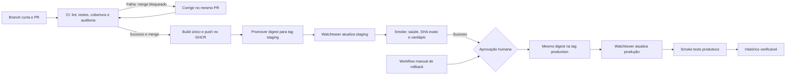

# ☕ Café com Deploy — Relatório de Voo


**Equipe e integrante:** Gabriel Ribeiro Peres · matrícula **82602166** · GitHub **GRPeres** · trabalho individual.

| Entrega | Link |
|---|---|
| Repositório público | [GRPeres/SistematizacaoEntrega](https://github.com/GRPeres/SistematizacaoEntrega) |
| Staging | [Documentação interativa](https://occasional-adjust-clause-issued.trycloudflare.com/docs) · [versão](https://occasional-adjust-clause-issued.trycloudflare.com/version) |
| Produção | [Documentação interativa](https://lady-valuation-discuss-finals.trycloudflare.com/docs) · [versão](https://lady-valuation-discuss-finals.trycloudflare.com/version) |
| Release inicial | [v1.0.0](https://github.com/GRPeres/SistematizacaoEntrega/releases/tag/v1.0.0) |
| Vídeo Game Day | Não gravado nesta revisão; o link será acrescentado se o vídeo for produzido. |

Staging e produção estão no TrueNAS SCALE, com PostgreSQL e configurações separados. Os hostnames gratuitos do Cloudflare podem mudar quando os túneis são recriados; nesse caso, é necessário atualizar estes links e as variáveis `APP_URL` dos GitHub Environments. A API não define `/`: use `/docs`, `/health`, `/version` ou `/cafes`.

## 1. Diagrama do pipeline



O artefato é identificado pelo SHA e pelo digest. As tags móveis `staging` e `production` apontam para esse mesmo artefato; não há novo build na promoção. Actions verifica o digest publicado e aguarda o SHA esperado na API. CD e rollback compartilham um grupo de concorrência para evitar alterações simultâneas nos canais.

**Evidência:** [primeiro deploy automatizado completo](https://github.com/GRPeres/SistematizacaoEntrega/actions/runs/39077694982), com CI, build, staging, aprovação e produção concluídos; [implantação da migration 3](https://github.com/GRPeres/SistematizacaoEntrega/actions/runs/39079320715).

## 2. Diagnóstico: antipadrões eliminados

| Crise original | Decisão e efeito |
|---|---|
| Copiar arquivos por FTP sem histórico | Código, Dockerfile, migrations e workflows no Git; mudanças por PR e Conventional Commits. |
| Fazer ALTER TABLE manualmente | Alembic aplica migrations versionadas na inicialização, antes da API. |
| Publicar preços incorretos sem validação | Testes de regras e API, cobertura mínima de 70%, lint e auditoria bloqueiam o merge. |
| Ambientes diferentes | Mesma imagem promovida por digest, com bancos e configurações separados. |
| Não saber qual versão está rodando | `/version` expõe o SHA; GHCR conserva a imagem selecionada. |
| Dependências sem controle | Versões fixadas, Dependabot e pip-audit no CI. |
| Recuperação improvisada | Workflow de rollback reponta o canal produtivo e verifica a versão restaurada. |

As decisões aplicam os princípios de Humble e Farley: automatizar o processo repetível, manter sua definição sob controle de versão e antecipar feedback. Configurações de ambiente ficam fora do código, conforme Twelve-Factor. A main exige PR e o check `qualidade`, inclusive para o administrador; como o trabalho é individual, a aprovação de revisão de PR pode ser zero. A aprovação do Environment de produção permanece obrigatória.

## 3. Estratégia de testes e demonstração do quality gate

| Camada/objetivo | Quantidade na revisão atual |
|---|---:|
| Unitários da regra de desconto | 13 |
| Integração API e banco | 11 |
| Evolução real do banco de 0002 para 0003 | 1 |
| Validação dos resultados de smoke tests | 5 |
| Seleção correta de deploys nas métricas | 3 |
| **Total pytest** | **33** |

Localmente os testes de API usam SQLite em memória; o teste de migration usa um arquivo descartável. No Actions, API e migrations usam PostgreSQL 16; a migration ganha um banco descartável próprio. Nunca são utilizados bancos de produção nos testes. A cobertura da aplicação é **96,47%**, acima do gate de 70%. O CI também executa `ruff check .` e `pip-audit -r requirements.txt`.

Os smoke tests reais, executados depois de cada promoção, verificam `/health`, o SHA completo em `/version` e pelo menos cinco cafés em `/cafes`. Eles não entram na contagem do pytest acima. A pirâmide concentra verificações de regras na base e mantém poucas verificações pela rede após o deploy.

### Erro barrado, correção e histórico

No [PR #13](https://github.com/GRPeres/SistematizacaoEntrega/pull/13), o [commit propositalmente defeituoso](https://github.com/GRPeres/SistematizacaoEntrega/commit/8b2b9774c3011f0536037ff2377048ed9c1fb1e2) trocou o máximo configurável por 100%, aceitando descontos inválidos. O [CI vermelho](https://github.com/GRPeres/SistematizacaoEntrega/actions/runs/39079696548) terminou com **3 falhas e 26 testes aprovados**: descontos de 51% e 80% não lançavam erro, e a rota retornava 200 em vez de 422. O PR ficou **BLOCKED**, conforme [registro do estado naquele momento](docs/evidence/ci-blocked.json). O código defeituoso não foi mesclado nem implantado.

O [commit de correção](https://github.com/GRPeres/SistematizacaoEntrega/commit/14f224bb05522bef3bac4cebcd29844ee488517f) restaurou a configuração e acrescentou um teste para limite personalizado de 25%. A [execução corrigida passou](https://github.com/GRPeres/SistematizacaoEntrega/actions/runs/39079775782), com 30 testes naquela etapa. A revisão final acrescenta os três testes de métricas, totalizando 33; [checks atuais do PR](https://github.com/GRPeres/SistematizacaoEntrega/pull/13/checks). A evidência distingue o histórico vermelho/verde da suíte final.

## 4. Gerência de dados: três migrations

| Revisão | Finalidade | Evidência |
|---|---|---|
| `0001` | Criação da tabela `cafes` | [Migration](migrations/versions/0001_create_cafes.py) |
| `0002` | Seed de cinco cafés e ajuste da sequência PostgreSQL | [Migration](migrations/versions/0002_seed_cafes.py) |
| `0003` | Coluna opcional `origem`, com padrão `Não informada` | [Migration](migrations/versions/0003_add_origem.py) · [PR #12](https://github.com/GRPeres/SistematizacaoEntrega/pull/12) |

A migration 3 entrou na pasta ativa **depois do primeiro deploy produtivo**. A Release v1.0.0 preserva a versão inicial, anterior a essa evolução. O [deploy posterior](https://github.com/GRPeres/SistematizacaoEntrega/actions/runs/39079320715) aplicou a terceira revisão automaticamente em staging e, após aprovação, em produção.

O teste de migration cria o banco até 0002, insere um sexto café, captura IDs/nomes/preços, aplica 0003 e confirma que tudo permanece igual. Verifica também o padrão em novas inserções e que repetir `upgrade head` não duplica dados. A comparação dos ambientes reais preservou os **cinco cafés anteriores**, agora com `origem`: [staging antes/depois](docs/evidence/migration3-staging.json) e [produção antes/depois](docs/evidence/migration3-production.json).

A evolução aplica a fase **expandir**: adiciona uma coluna sem remover ou renomear as anteriores. A fase **contrair**, caso necessária no futuro, só ocorreria após migração dos consumidores e dados. Rollback da aplicação não executa `alembic downgrade`. Embora o SQL antigo continue compatível com a coluna extra, imagens anteriores à revisão 0003 não conhecem essa revisão no startup do Alembic: **após essa migração, o alvo de rollback deve conter a revisão 0003; não usar a baseline `abc12a0`**.

## 5. Métricas DORA com dados reais

**Recorte fixado em 17/10/2026, às 20:39:22, horário de Brasília (UTC−3).** Os valores abaixo são uma fotografia para esta entrega, não um contador atualizado a cada acesso. Os dados e horários UTC estão em [dora-2026-10-17.json](docs/evidence/dora-2026-10-17.json).

| Indicador | Resultado observado | Cálculo e limite |
|---|---|---|
| Frequência de deploy | **2 deploys progressivos e 1 rollback no dia observado** | Dois jobs produtivos concluídos com smoke tests; a reimplantação de recuperação é apresentada separadamente. |
| Lead time médio | **2 h 03 min 55 s** | Média de 14.658 s e 212 s: `(14.658 + 212) / 2 = 7.435 s`. Do horário do commit de integração ao fim do smoke produtivo. |
| Taxa de falha de mudanças | **0% registrado, 0/2 deploys progressivos** | Nenhum incidente produtivo registrado nesta amostra. Falhas em PRs e o rollback de exercício não entram como incidentes produtivos. |
| Recuperação no exercício de rollback | **64 s (1 min 04 s)** | Da solicitação do workflow às 20:11:52 até a verificação da recuperação às 20:12:56; inclui espera/aprovação e execução. |

| Deploy | Commit integrado, Brasília | Smoke produtivo concluído, Brasília | Lead time |
|---|---|---|---|
| [Primeira promoção](https://github.com/GRPeres/SistematizacaoEntrega/actions/runs/39077694982) | 17/10, 16:05:07 | 17/10, 20:09:25 | 4 h 04 min 18 s |
| [Migration 3](https://github.com/GRPeres/SistematizacaoEntrega/actions/runs/39079320715) | 17/10, 20:30:52 | 17/10, 20:34:24 | 3 min 32 s |

A primeira entrega inclui o tempo de preparação da infraestrutura e aprovação, explicando seu lead time maior. Não é uma medição apenas do tempo de execução do CI. O [rollback verificado](https://github.com/GRPeres/SistematizacaoEntrega/actions/runs/39078078308) foi um exercício controlado sobre uma versão saudável: **64 s é o tempo observado do exercício, não uma alegação de MTTR de incidente real**. Não houve início de indisponibilidade registrado; a recuperação de falha produtiva real permanece sem amostra.

O [registro de incidentes](docs/incident-register.json) explicita essa classificação. Dois workflows CD verdes foram excluídos da frequência porque tinham produção desabilitada: build concluído não significa deploy concluído. O script consulta os jobs e conta somente produção efetivamente verificada. A taxa de falha se limita ao registro deste projeto e não representa garantia estatística de ausência de falhas. A amostra pequena não permite classificar maturidade.

Reproduzir a coleta atual, mantendo a fotografia original intacta:

```bash
python scripts/dora.py GRPeres/SistematizacaoEntrega --output metricas-atualizadas.json
```

A definição de recuperação após falha produtiva e a distinção de falhas de mudança seguem [DORA](https://dora.dev/guides/dora-metrics/). O trabalho apresenta os quatro indicadores solicitados pelo enunciado.

## 6. Reflexão: entrega contínua ou implantação contínua?

A Café com Deploy deve manter **entrega contínua com aprovação manual em produção** nesta etapa. A imagem já fica pronta e validada em staging, mas o histórico observado é curto e a aprovação permite conferir impacto, dados e compatibilidade de migrations antes da promoção. O ganho principal foi substituir passos improvisados por um processo repetível e rastreável, com feedback rápido e recuperação demonstrada. Implantação contínua sem aprovação pode ser considerada depois de acumular evidências de estabilidade, observabilidade e reversão compatível com a evolução do banco. A aprovação não substitui testes; complementa a decisão de liberar uma mudança que já passou pelos gates.

## 7. Integrante, papéis e contribuição individual

| Nome / equipe | Matrícula | GitHub | Papéis acumulados | Evidências de autoria |
|---|---|---|---|---|
| Gabriel Ribeiro Peres | 82602166 | [GRPeres](https://github.com/GRPeres) | Desenvolvimento, Release Manager, testes, plataforma, DBA e documentação | [PR #11](https://github.com/GRPeres/SistematizacaoEntrega/pull/11), [PR #12](https://github.com/GRPeres/SistematizacaoEntrega/pull/12), [PR #13](https://github.com/GRPeres/SistematizacaoEntrega/pull/13) |

Minha contribuição foi preparar e publicar o projeto, configurar staging e produção no meu TrueNAS SCALE, validar o pipeline com aprovação e rollback e registrar as evidências. A escolha por Actions, GHCR e Watchtower permitiu promover a mesma imagem e atualizar a aplicação sem disponibilizar uma interface pública de administração do NAS. Também acompanhei a evolução do banco sem perda dos registros anteriores, a revisão de dependências e a demonstração de uma alteração inválida bloqueada pelo CI.

## Dependabot: decisão de revisão registrada

O [PR #1](https://github.com/GRPeres/SistematizacaoEntrega/pull/1) propôs trocar Python 3.12 por 3.14 no Dockerfile. O CI estava verde, mas continuava em Python 3.12 e não validava a imagem proposta. A atualização foi **fechada após revisão**, com [justificativa técnica no próprio PR](https://github.com/GRPeres/SistematizacaoEntrega/pull/1#issuecomment-6243170481): manter paridade nesta entrega e tratar a atualização de runtime em mudança própria, incluindo CI e validação do container. Dependabot permanece ativo. Isso demonstra avaliação da atualização, não aprovação automática de qualquer PR verde.

## Operação e reprodução

- [Configuração Watchtower e promoção](WATCHTOWER-SETUP.md); [implantação inicial TrueNAS](NAS-SETUP.md).
- Python 3.12 no CI e Docker; Dockerfile multi-stage e usuário não-root.
- Dependências de topo fixadas; pip-audit em cada PR. Permissões de escrita no GHCR somente nos jobs que publicam/promovem imagens.
- Bancos separados por app/ambiente; senhas ficam na configuração privada do NAS. Não publicar YAML preenchido com credenciais.
- Em `/cafes`, `/cafes/{id}` e `/cafes/{id}/preco?desconto=10`, a API permite consultar catálogo, item e preço com desconto; `POST /cafes` cria um item, validando preço e duplicidade.

```bash
# Ambiente local: API, PostgreSQL e migrations até 0003
 docker compose up --build
# Testes locais após criar/ativar um ambiente virtual
 python -m pip install -r requirements-dev.txt
 pytest --cov=app --cov-report=term-missing --cov-fail-under=70
 ruff check .
```

Na configuração instalada do NAS, Watchtower consulta os canais a cada 30 segundos. Após cada merge corrigido na main, acompanhe Actions; aprove produção somente após staging passar. Para rollback, use um SHA estável compatível com as migrations já aplicadas. Se um CD estiver esperando aprovação, cancele-o antes de um rollback urgente para liberar o grupo de concorrência.

## Evidências concluídas e entrega pessoal

- [x] Repositório público, main protegida e PRs com histórico vermelho/verde.
- [x] CI com PostgreSQL, testes significativos e cobertura superior a 70%.
- [x] Imagem GHCR, promoção do mesmo digest, aprovação e dois ambientes online.
- [x] Rollback executado e verificado no exercício anterior à migration 3.
- [x] Três migrations aplicadas, com comparação dos dados reais.
- [x] PR Dependabot revisado e fechado com justificativa.
- [x] Release v1.0.0 e Relatório de Voo com métricas rastreáveis.
- [ ] Vídeo Game Day: ainda não gravado; não há link nesta revisão.
- [ ] PDF individual no AVA: envio deve ser feito pelo integrante.

## Referências

- HUMBLE, J.; FARLEY, D. *Entrega contínua*. Bookman, 2014.
- FORSGREN, N.; HUMBLE, J.; KIM, G. *Accelerate*. IT Revolution, 2018.
- KIM, G. et al. *Manual de DevOps*. Alta Books, 2018.
- [Twelve-Factor App](https://12factor.net/pt_br/).
- [GitHub Actions](https://docs.github.com/pt/actions).
- [Watchtower: scopes](https://containrrr.dev/watchtower/running-multiple-instances/).
- [DORA: métricas de entrega](https://dora.dev/guides/dora-metrics/).
