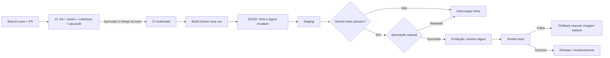

# ☕ Café com Deploy — CI/CD sem medo da sexta-feira

> **Projeto acadêmico — Pós-graduação CEUB, Integração e Entrega Contínuas.**
> Este repositório contém a implementação e a preparação de infraestrutura. Resultados de implantação só serão registrados após execução real.
> **Destino escolhido: TrueNAS SCALE.** Consulte [NAS-SETUP.md](NAS-SETUP.md). Staging e produção foram verificados em 17/10/2026. O pipeline Watchtower está implementado; sua ativação e validação ponta a ponta seguem [WATCHTOWER-SETUP.md](WATCHTOWER-SETUP.md).


| Item | Link |
|---|---|
| Repositório público | `https://github.com/GRPeres/SistematizacaoEntrega` |
| Staging | [API staging](https://carl-wait-cingular-holder.trycloudflare.com) |
| Produção | [API produção](https://fonts-sacramento-nations-reflection.trycloudflare.com) |
| Release v1.0.0 | **PREENCHER:** `https://github.com/.../releases/tag/v1.0.0` |
| Game Day (vídeo) | **PREENCHER:** URL pública/não listada (o vídeo é opcional no início do enunciado, porém há 5% associados na rubrica) |

## 1. Diagrama do pipeline



**Regras essenciais:** toda PR precisa passar pelo quality gate; nenhuma imagem é reconstruída entre staging e produção; configuração fica em variáveis e secrets; migrations são versionadas; um deploy com teste vermelho não prossegue.

## Como executar localmente

**Pré-requisitos:** Git, Docker + Docker Compose (ou Python 3.12 e um PostgreSQL).

```bash
# inicia Postgres e API; aplica migrations 0001 e 0002 automaticamente
docker compose up --build

# Em outro terminal:
curl http://localhost:8000/health
curl http://localhost:8000/version
curl http://localhost:8000/cafes
curl "http://localhost:8000/cafes/1/preco?desconto=10"
# Swagger: http://localhost:8000/docs
```

Sem Docker, para testar rapidamente após instalar as dependências:

```bash
python -m venv .venv
source .venv/bin/activate      # Windows: .venv\\Scripts\\activate
python -m pip install -r requirements-dev.txt
pytest --cov=app --cov-report=term-missing --cov-fail-under=70
ruff check .
```

Os testes usam SQLite em memória **somente quando** `TEST_DATABASE_URL` não está definido. O CI executa os mesmos testes de integração com PostgreSQL em um **service container exclusivo**, jamais com o banco de produção.

### Endpoints implementados

| Método | Endpoint | Comportamento |
|---|---|---|
| GET | `/health` | `{"status":"ok"}` |
| GET | `/version` | SHA da imagem, via `APP_VERSION` |
| GET | `/cafes` | Lista do cardápio |
| POST | `/cafes` | Adiciona café; 409 para nomes repetidos |
| GET | `/cafes/{id}` | Café ou 404 |
| GET | `/cafes/{id}/preco?desconto=10` | Preço com desconto de 0 a 50%, ou 422 |

Exemplo de novo café:

```bash
curl -X POST http://localhost:8000/cafes \
  -H 'Content-Type: application/json' \
  -d '{"nome":"Bourbon Amarelo","preco":"21.90"}'
```

## 2. Diagnóstico da crise e correções

| Antipadrão observado | Solução implementada |
|---|---|
| FTP e deploy manual sem histórico | CD automático após merge; GHCR com SHA/digest |
| Um `ALTER TABLE` manual em produção | Alembic em cada inicialização/implantação (demonstração) |
| Preços alterados sem testes | Testes unitários + integração de API + coverage gate |
| Configuração/segredo no código | `.env.example`, `.gitignore`, GitHub Environment secrets |
| Sem ambiente similar à produção | Mesmo Dockerfile e mesmo digest, com variáveis isoladas |
| Não se sabia qual versão estava no ar | `/version`, label OCI revision e imagem com SHA |
| Sem recuperação documentada | Workflow manual de rollback com smoke test |
| Dependências sem controle | `requirements*.txt` fixados, Dependabot e pip-audit |

Princípios aplicados: automação, feedback rápido, rastreabilidade do commit ao artefato, consistência de ambientes e princípio *stop the line* em caso de falha, conforme a fundamentação fornecida no trabalho.

## 3. Estratégia de testes

A pirâmide tem **testes unitários** da regra `preco_com_desconto`, **testes de integração** API + banco SQLAlchemy (Postgres no Actions; SQLite em memória local) e **smoke tests** de `/health` e `/version` após cada deploy.

- **Quantidade preparada:** 28 testes coletados localmente (12 de regras, 11 de API e 5 do gate de implantação).
- **Evidência local inicial:** 28 passaram e 96% de cobertura da aplicação. Esse resultado não comprova o comportamento do PostgreSQL remoto.
- **Quality gate:** `pytest --cov=app --cov-fail-under=70`, lint Ruff e auditoria `pip-audit -r requirements.txt` em cada PR.
- **Evidência final a preencher:** link do Actions CI com testes PostgreSQL verdes + relatório de cobertura no próprio log.

Para demonstrar o **erro barrado**, abra PR **temporária** que altera a validação em `app/main.py` para aceitar 80% (ex.: alterar `DESCONTO_MAXIMO` para 100 apenas no branch). O teste `test_desconto_invalido` deve falhar, e a regra da `main` deve bloquear merge. Corrija, rode CI novamente e só então faça merge. **Não leve bug proposital para produção.**

## 4. Gerência de dados e migrations

| Migration | Onde | Quando aplicar | Propósito |
|---|---|---|---|
| `0001_create_cafes` | `migrations/versions/` | 1º deploy | Cria `cafes` |
| `0002_seed_cafes` | `migrations/versions/` | 1º deploy | Insere 5 cafés e ajusta sequência no Postgres |
| `0003_add_origem` | `extras/migration3/` | **Depois da primeira produção** | Adiciona coluna opcional `origem`, preservando preços e linhas |

**Muito importante:** o enunciado exige que a Migration 3 seja **criada depois do primeiro deploy em produção**. Por isso ela está propositalmente fora da pasta ativa. Depois de gravar evidência da `v1.0.0` em produção, crie branch e ative a terceira migration:

```bash
git switch -c feat/origem-cafe
python scripts/ativar_migration3.py
# confira se migrations/versions/0003_add_origem.py foi criada
git add migrations/versions/0003_add_origem.py
git commit -m "feat: adiciona migration de origem sem perder dados"
git push -u origin feat/origem-cafe
# abra PR, espere CI, merge na main e registre novo deploy
```

**Expandir e contrair:** a mudança primeiro **expande** o esquema com coluna opcional e padrão, sem excluir a coluna existente e sem alterar os dados de `nome`/`preco`. Uma mudança futura de remoção/contração exigiria período de compatibilidade e migração dos dados. O rollback de aplicação **não executa `alembic downgrade`**.

**Bancos:** `staging` e `production` devem apontar para bancos separados. O workflow de CI tem um terceiro banco descartável. A credencial `cafe:cafe` do Compose serve **apenas para demonstração local**.

## 5. Infraestrutura e ambientes

- `Dockerfile` multi-stage, Python 3.12 e usuário não-root.
- `docker-compose.yml`: ambiente local. `compose.nas.yml`: imagem GHCR por digest, banco persistente e portas locais 8001/8002.
- TrueNAS SCALE: dois apps separados, `cafe-staging` e `cafe-production`, com PostgreSQL, credenciais e volumes distintos.
- `deploy/truenas-quick.yml`: modelo para instalar cada app pela interface TrueNAS com hostname gratuito temporário do Cloudflare.

**Ativação:** [WATCHTOWER-SETUP.md](WATCHTOWER-SETUP.md). CD promove o digest do build para `:staging`, verifica a versão pública, solicita aprovação e promove o mesmo digest para `:production`. Watchtower aplica as tags em instâncias com escopos separados. `WATCHTOWER_ENABLED=true` habilita a promoção; até a instalação no NAS e uma execução completa, não há evidência ponta a ponta. A imagem usa nome minúsculo: `ghcr.io/grperes/sistematizacaoentrega`.

No GitHub, exigir PR e check `qualidade` na main; criar Environments `staging` e `production`, configurar a variável `APP_URL` de cada ambiente e exigir aprovação humana de produção. Esses requisitos devem ser comprovados com execuções reais antes da entrega. A imagem de produção deve usar o mesmo digest aprovado em staging.

## 6. Dependências e segurança

- Todas as dependências de topo têm versões fixadas.
- `.github/dependabot.yml` abre PRs semanais para `pip`, `github-actions` e `docker`.
- `pip-audit` roda no CI. Uma vulnerabilidade detectada **deve bloquear o fluxo**; resolva atualizando/avaliando a dependência em PR, não escondendo o erro.
- Permissões por padrão `contents: read`; somente o job que publica no GHCR recebe `packages: write`.
- Senhas e tokens ficam em configuração privada; não copiar para issues, README ou Git.
- **Evidência pendente:** link para um PR real do Dependabot tratado (mesclado com CI verde ou fechado com justificativa).

## 7. Gerência de releases, rollback e Game Day

### Release v1.0.0

Depois de concluir o primeiro deploy e confirmar `/version`:

```bash
git switch main
git pull
git tag -a v1.0.0 -m "Primeira versão estável da Café com Deploy"
git push origin v1.0.0
```

No GitHub, entre em **Releases > Draft a new release**, escolha `v1.0.0` e publique notas geradas. Não é suficiente apenas criar a tag: registre uma Release visível.

### Rollback

Em **Actions > rollback > Run workflow**, informe o **SHA curto de sete caracteres** de uma imagem anteriormente estável (disponível em GHCR ou em uma execução anterior do CD). O job de produção precisa de aprovação. Registre o momento da falha, da decisão de rollback e da confirmação de `/health` e `/version` para calcular a recuperação. Não execute rollback em migrações destrutivas.

### Roteiro do vídeo Game Day (até 6 minutos)

1. **Abertura:** apresentem equipe/papéis e `GET /version` em produção.
2. **Erro barrado:** PR com desconto 80% aceito; mostrem CI vermelho e merge bloqueado.
3. **Correção:** voltem o limite a 50%; CI verde, PR aprovada e merge.
4. **Viagem:** CD com build, staging, smoke tests, pedido de aprovação e produção com novo SHA.
5. **Rollback:** executem o workflow manual com SHA anterior; mostrem `/version` voltando e cronometrem a recuperação.
6. **Lições:** relatem DORA a partir do próprio histórico e a principal melhoria percebida.

**Evidência final:** vídeo público ou não listado com acesso liberado e link de cada integrante.

## 8. Métricas DORA e reflexão (Relatório de Voo)

**Não invente indicadores.** Preencha após as execuções reais, mostrando links de workflows e horários.

| Indicador | Valor real a inserir | Como coletar |
|---|---|---|
| Frequência de deploy | `PREENCHER` produção / intervalo | `cd.yml` concluído com sucesso até `production` |
| Lead time médio de mudanças | `PREENCHER` horas | instante do commit → deploy produtivo concluído |
| Taxa de falha de mudanças | `PREENCHER` % | deploys produtivos que causaram incidente/rollback ÷ deploys produtivos × 100 |
| Tempo de recuperação | `PREENCHER` minutos | detecção da falha → `GET /health` e `/version` restaurados |

O script `python scripts/dora.py USUARIO/REPO` lê histórico real de execuções no GitHub para auxiliar na contagem de deploys e lead time. Ele **não** inventa taxa de falha ou tempo de recuperação, que exigem registro do incidente. Faça as contas do vídeo com os timestamps reais.

**Reflexão proposta:** nesta fase, a Café com Deploy **deve manter a aprovação manual em produção**. Embora os testes e as verificações automáticas reduzam risco, ainda é uma equipe aprendendo a garantir observabilidade, segurança de migrações e rollback testado. A implantação contínua sem aprovação pode ser avaliada após histórico de releases estáveis, monitoramento contínuo e incidentes controlados. A automação deve reduzir risco, não remover responsabilidade.

### Integrantes e papéis

| Nome | Matrícula | GitHub | Papel rotativo | Link de PR/commit de autoria |
|---|---|---|---|---|
| `PREENCHER` | `PREENCHER` | `PREENCHER` | Release Manager / Dev / QA / DBA | `PREENCHER` |

## Checklist final para cada integrante

- [ ] Repositório público com PR obrigatório e histórico de CI vermelho/verde.
- [ ] Pelo menos 8 testes em 2 camadas, cobertura ≥70% e CI PostgreSQL verde.
- [ ] GHCR com imagem pública, SHA/digest e duas implantações **reais**.
- [ ] `staging` e `production` respondem em `/health` e `/version`.
- [ ] Aprovação manual registrada no histórico do CD.
- [ ] Rollback real executado, verificado e cronometrado.
- [ ] 3 migrations aplicadas **na ordem temporal exigida**.
- [ ] Um PR do Dependabot analisado pela equipe.
- [ ] Tag + Release `v1.0.0` publicadas.
- [ ] README preenchido com indicadores DORA **reais**, links e autores.
- [ ] Vídeo Game Day gravado com roteiro e acesso liberado.
- [ ] Cada integrante envia **seu próprio PDF** `sistematizacao-iec-<equipe>.pdf` no AVA, com sua contribuição e link de commit/PR.

## Referências do enunciado

- HUMBLE, J.; FARLEY, D. *Entrega contínua: como entregar software de forma rápida e confiável*. Bookman, 2014.
- FORSGREN, N.; HUMBLE, J.; KIM, G. *Accelerate*. IT Revolution, 2018.
- KIM, G. et al. *Manual de DevOps*. Alta Books, 2018.
- [Twelve-Factor App](https://12factor.net/pt_br/).
- [Documentação GitHub Actions](https://docs.github.com/pt/actions).
- [DORA Software Delivery Metrics](https://dora.dev/).


